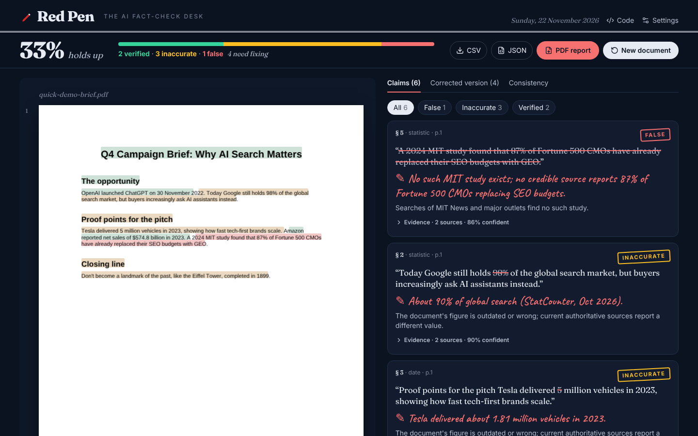
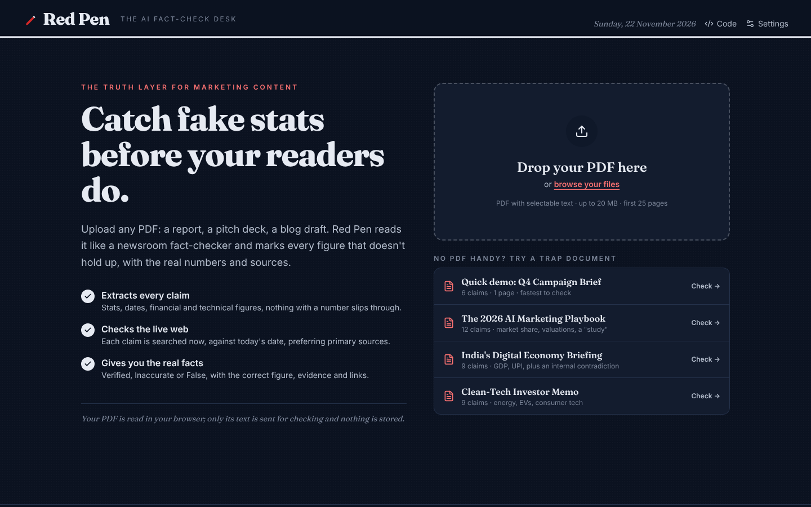
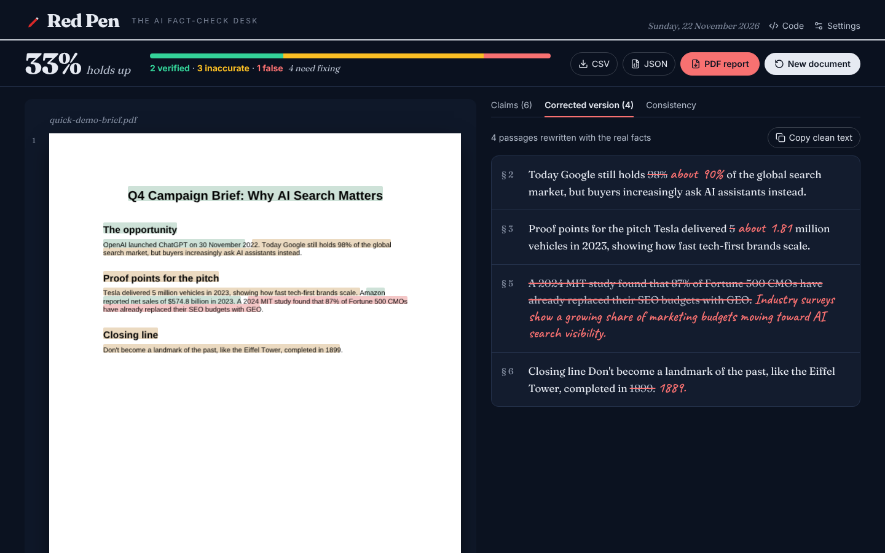

# ✎ Red Pen: an AI fact-check desk for marketing PDFs

> **Upload a PDF. Red Pen extracts every stat, date and figure, checks each one against the live web, and marks what's wrong, with the real facts, evidence and sources.**

**🔗 Live app: [red-pen-project.vercel.app](https://red-pen-project.vercel.app)** · **🎬 Demo video (30 s):** `<add link>`


<sub>UI preview of the report screen: PDF with verdict-coloured highlights on the left, proof-marked claim cards on the right.</sub>

---

## Contents

[Try it in 1 minute](#try-it-in-1-minute) · [Assessment checklist](#assessment-checklist) · [The problem](#the-problem) · [What it does](#what-it-does) · [How verification works](#how-the-verification-works-and-why-it-catches-trap-documents) · [Tech stack](#tech-stack) · [Project structure](#project-structure) · [Run locally](#run-locally) · [Deploy](#deploy-to-vercel) · [Configuration](#configuration) · [Test documents](#test-documents-answer-keys) · [Limitations](#limitations)

## Try it in 1 minute

1. Open **https://red-pen-project.vercel.app**
2. Drop in **your own PDF** (text-based, up to 25 pages), or click one of the built-in trap documents, e.g. **"AI Search Brand Visibility Report"**.
3. Watch claims appear and flip to **Verified / Inaccurate / False** as each is checked on the live web.
4. Click any card to jump to the claim in the PDF; open **Evidence** for the source quote and links.
5. See the **Corrected version** tab, then download the **PDF report**.

> If the hosted API quota is exhausted, open **Settings** (top-right), pick **Google Gemini** or **OpenAI**, and paste your own key. It stays in your browser tab's memory only.

## Assessment checklist

| Requirement | Where it's met |
|---|---|
| **Extract** specific claims (stats, dates, financial/technical figures) from the PDF | `factcheck/claims.py`: LLM extraction + a regex *recall guard* that re-checks every sentence containing a number |
| **Verify** against live web data | `factcheck/verifier.py`: Gemini + Google Search grounding (or OpenAI `web_search`), date-aware, ≥ 2 searches per claim |
| **Report** Verified / Inaccurate / False | Claim cards, trust score, CSV / JSON / **PDF report** (`src/lib/pdfReport.ts`) |
| Flag fake stats **and give the correct real facts** | Every flagged claim shows the **real fact** (with as-of date), an evidence quote and sources; the **Corrected version** rewrites the passage |
| Simple frontend for PDF upload (Streamlit / Gradio / **React**) | React + TypeScript (`src/`) |
| **Deployed** and testable with your own PDF | Vercel: https://red-pen-project.vercel.app |
| Clean code, `requirements.txt`, README | Python package + FastAPI API, `requirements.txt`, typed React app, 32 offline tests |

## The problem

Marketing content is full of numbers that *sound* authoritative but are outdated ("Instagram has 1 billion users"), inflated ("Tesla delivered 5 million cars in 2023") or invented ("a 2025 Harvard study found…"). Red Pen is a **truth layer**: it reads a document the way a newsroom fact-checker would and flags every claim that doesn't hold up **before** it is published.

Every claim gets one of three verdicts:

| Verdict | Meaning |
|---|---|
| ✓ **Verified** | Matches current, reliable data |
| ≠ **Inaccurate** | Real topic, but the figure is wrong, exaggerated or **outdated**. Red Pen gives the correct, latest figure |
| ✗ **False** | No credible evidence: a fabricated statistic, a non-existent study, an invented event |

Each verdict also carries a **confidence score**; borderline claims get an automatic second check.

## What it does

- **Extracts** every checkable claim (statistics, dates, financial and technical figures, named-entity facts), rewritten as a self-contained sentence with the verbatim quote and page.
- **Verifies** each claim against the **live web**, using **Gemini + Google Search grounding** or **OpenAI + web search**. Checks are date-aware and prefer primary sources.
- **Reports** the verdict, the **real fact**, a short explanation, an **evidence quote** from the source, links and a confidence score.
- **Highlights the claims inside the PDF**, coloured by verdict. Click a highlight to jump to its card, and vice versa.
- **Writes a corrected version** of every flagged passage, shown as editor's proof marks (~~wrong~~ ✎ right), with "copy clean text".
- **Checks internal consistency**: flags places where the document contradicts itself.
- **Trust score**: the share of checked claims that hold up.
- **Downloads a PDF report**: score and verdict summary, every claim with its real fact, evidence and sources, the corrected passages, and then your original document with each claim boxed in its verdict colour and numbered. CSV and JSON exports too.
- **Reviewer-proof**: five built-in trap documents, automatic wait-and-retry on API rate limits (with a visible countdown), a "re-check failed claims" button, and bring-your-own-key (Gemini or OpenAI).

<p>
  
  
</p>

## How the verification works (and why it catches trap documents)

```
PDF ─► pdf.js (in the browser): render pages + extract positioned text
    ─► POST /api/extract
         1. LLM extracts self-contained claims (+ verbatim quote, page, search query)
         2. Recall guard: regex finds EVERY sentence containing a number, %, currency
            or year; any sentence whose figures no claim covers is re-extracted.
            → a planted lie can't slip through extraction.
    ─► POST /api/verify   (one request per claim, 2 in parallel, live progress)
         • today's date is in the prompt → old stats presented as current = Inaccurate
         • ≥ 2 web searches (Google Search grounding or OpenAI web_search):
           the claim itself + "latest <topic> <year>"
         • source priority: official/primary → statistics agencies → reputable news
         • returns verdict, correct fact (with as-of date), evidence quote, sources
         • confidence < 70 → automatic second opinion with different queries,
           then reconciled (agreement raises confidence; a tie keeps the flag,
           because missing a planted error is worse than a false alarm)
         • rate limited? → HTTP 429 + Retry-After; the browser waits and retries
    ─► POST /api/consistency  internal contradictions across the document's claims
    ─► POST /api/correct      rewrites each flagged passage with the real facts
```

Design choices worth noting:

| Decision | Why |
|---|---|
| The browser orchestrates short requests (one per claim) instead of one long job | Stays well inside serverless time limits, and the user watches verdicts land live |
| PDF parsed client-side with pdf.js | No upload-size limits on the server, and the same text positions power the highlights and the marked-up PDF report |
| Recall guard on top of LLM extraction | LLMs sometimes skip "boring" figures; traps hide exactly there |
| Evidence quote + sources per verdict | A fact-check you can't audit isn't a fact-check |
| Provider-agnostic LLM layer | Gemini or OpenAI behind one `complete()` interface; switchable per request |
| Failure isolation | One failed claim shows "Not checked" with the reason; the rest of the report still completes |

## Tech stack

- **Frontend:** React 19, TypeScript, Vite, Tailwind CSS 4, pdf.js (rendering + text), pdf-lib (PDF report), lucide icons
- **Backend:** Python 3, FastAPI, Pydantic, served as a single Vercel Python function (`api/index.py`)
- **AI:** Google Gemini with Google Search grounding (default `gemini-3.5-flash-lite`) **or** OpenAI Responses API with `web_search` (default `gpt-4.1-mini`)
- **Hosting:** Vercel (static frontend + Python serverless function)
- **Tests:** pytest (32 tests, LLM faked; no API key needed), TypeScript type-checking

## Project structure

```
api/
  index.py                FastAPI routes: /api/health, extract, verify, consistency, correct
factcheck/                Python package: all fact-checking logic, no web framework code
  claims.py               claim extraction + numeric-sentence recall guard
  verifier.py             live-web verification, second opinion, reconcile()
  review.py               internal contradictions + corrected passages
  llm.py                  Gemini + OpenAI clients, citations, JSON recovery, rate-limit handling
  models.py               Pydantic models (Claim, ClaimResult, Verdict…)
src/                      React app
  App.tsx                 page shell: upload ↔ workspace, settings, exports
  hooks/useFactCheck.ts   workflow state machine (read → extract → verify → review)
  lib/api.ts              API client + retry/back-off on rate limits
  lib/pdf.ts              pdf.js rendering + positioned text
  lib/highlight.ts        maps claim quotes to highlight rectangles
  lib/pdfReport.ts        marked-up PDF + report pages (pdf-lib)
  lib/diff.ts             word diff for proof marks
  components/             UploadScreen, SummaryBar, PdfViewer, ClaimCard, ReviewTabs, SettingsDrawer…
public/samples/           trap PDFs used by the "Try a trap document" buttons
samples/                  scripts that generate the trap PDFs (with answer keys)
tests/                    pytest suite: extraction, verification, providers, API
docs/screenshots/         README images
requirements.txt          Python runtime dependencies (used by Vercel)
requirements-dev.txt      + test / local-dev tools
package.json              frontend dependencies and scripts
vercel.json               build + Python function config
```

## Run locally

Prerequisites: Python 3.10+, Node 20+, and a Gemini key ([aistudio.google.com/apikey](https://aistudio.google.com/apikey)) or an OpenAI key.

```bash
git clone https://github.com/niharikabhatia/red-pen.git
cd red-pen
pip install -r requirements-dev.txt
npm install
cp .env.example .env    # then put your key in .env, or export it:
export GEMINI_API_KEY=AIza...
```

Terminal 1: API on http://localhost:8000
```bash
npm run api
```

Terminal 2: app on http://localhost:5173 (proxies `/api` to :8000)
```bash
npm run dev
```

Tests (no API key needed):
```bash
pytest -q
npm run lint
```

## Deploy to Vercel

1. Push this repository to GitHub.
2. In Vercel: **Add New → Project → Import** the repo. The *Vite* preset is detected; `vercel.json` configures the Python function and its dependencies come from `requirements.txt`.
3. **Settings → Environment Variables:** add `GEMINI_API_KEY` and/or `OPENAI_API_KEY` for **Production** (see below).
4. Deploy, then check `https://<your-app>.vercel.app/api/health` shows `"server_key": true`.

## Configuration

| Variable | Required | Default | Notes |
|---|---|---|---|
| `GEMINI_API_KEY` | one of the two | | Google Gemini key. Used by default when set |
| `OPENAI_API_KEY` | one of the two | | OpenAI key (needs billing credit) |
| `LLM_PROVIDER` | | auto | Force `gemini` or `openai` |
| `GEMINI_MODEL` | | `gemini-3.5-flash-lite` | Any Gemini model that supports Google Search grounding |
| `OPENAI_MODEL` | | `gpt-4.1-mini` | Any Responses-API model that supports `web_search` |

**Quotas:** Gemini's free tier allows only a small number of Google-Search-grounded requests per day; enable billing on the key's project for reliable use (a typical document costs well under a cent per claim). Red Pen checks two claims at a time and automatically waits out per-minute rate limits, showing a countdown.

## Test documents (answer keys)

Five trap PDFs ship with the app (`public/samples/`); their generators and answer keys are in `samples/`.

**AI Search Brand Visibility Report** (10 claims: 6 correct, 3 wrong, 1 borderline)

| Document says | Expected | Real fact |
|---|---|---|
| OpenAI released GPT-4 in March 2023 | ✓ Verified | |
| Perplexity AI was founded in 2022 | ✓ Verified | |
| Microsoft first invested $1 billion in OpenAI in 2019 | ✓ Verified | |
| Alphabet revenue about $307 billion in 2023 | ✓ Verified | |
| ChatGPT launched on 30 November 2022 | ✓ Verified | |
| Google AI Overviews launched in the US in May 2024 | ✓ Verified | |
| Instagram has 1 billion monthly active users | ≠ Inaccurate | Outdated (2018); 2B+ today |
| Google processes ~3.5 billion searches per day | ≠ Inaccurate | Outdated; Google cites 5+ trillion searches a year |
| 2025 Harvard study: 78% of B2B buyers start in ChatGPT | ✗ False | No such study |
| ~60% of Google searches end without a click | Borderline | Studies vary; expect lower confidence |

Other samples include: Google "98%" of search (≠, ~90%), Tesla "5 million" deliveries in 2023 (≠, ~1.81M), a fake "2024 MIT study" (✗), and an internal contradiction ("UPI launched in 2016" vs "since UPI's launch in 2019").

## Limitations

- Scanned / image-only PDFs are not supported (no OCR yet).
- Up to 25 pages and 40 claims per document, to keep cost and latency bounded.
- Verdicts depend on what is findable on the open web; paywalled data may come back as "False (no evidence)".
- LLM judgements can still be wrong: the evidence quote, sources and confidence score are there so a human can confirm.

## Roadmap

OCR for scanned PDFs · URL and Google Docs input · shareable report links · a browser extension to fact-check while writing · a team workspace with a "fact sheet" of approved company figures, the "Brand Truth Engine" idea from Part 1 of the assessment.
